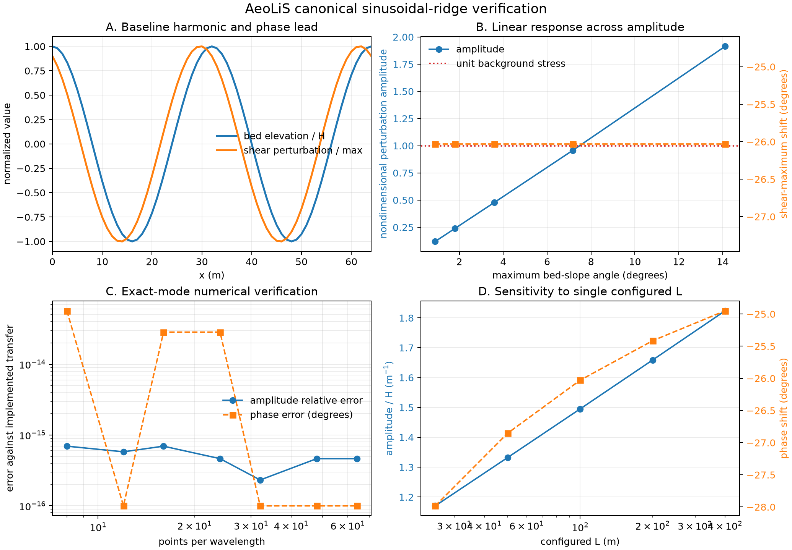

# Canonical sinusoidal-ridge verification: preliminary findings

## Status

Benchmark run produced on 25 October 2026 against AeoLiS `3.1.0rc1`, commit `1fcbe86d173f964e6ee231c0ee917ca3a6cd3f5e`.

This is an **implementation-verification** experiment. It checks whether the numerical FFT operator evaluates its documented transfer function consistently. It is not independent evidence that the transfer function reproduces CFD or field physics.

## Experiment

The bed is an exact periodic mode

```math
h(x)=H\cos(2\pi x/\lambda),
```

with `lambda = 32 m`, `z0 = 0.001 m`, wind along positive `x`, no high-frequency filter, and four wavelengths in the computational domain. The fitted response is

```math
\delta\tau_x=a\cos(kx)+b\sin(kx)+c.
```

Amplitude and phase are compared with the complex Fourier transfer coefficient reconstructed independently from the equations implemented in `WindShear.compute_shear`.

## Main numerical result

The verification passes:

- maximum relative amplitude error: `6.96e-16`;
- maximum absolute phase error: `5.68e-14 degrees`;
- maximum transverse-shear RMS: `0`;
- normalized-gain spread across the amplitude sweep: `0`.

For this exact periodic Fourier mode, AeoLiS therefore evaluates the implemented along-wind transfer formula to floating-point precision.

## Baseline interpretation



**Figure 1. Surface shear over a periodic sinusoidal ridge.** Wind blows toward increasing x. Panel A locates the shear maximum relative to the crest. Panel B shows that doubling ridge height doubles the perturbation while leaving the phase unchanged at fixed wavelength. Panel C compares the computed response with the same transfer equation evaluated separately. Panel D shows how the configured model length scale changes the prediction for identical terrain.

For `H/lambda = 0.02`, corresponding to a maximum bed-slope angle of `7.16 degrees`, the result is:

- normalized shear gain: `1.4951 m^-1`;
- shear maximum phase: `-26.03 degrees` relative to the crest;
- spatial shift: `-0.0723 lambda`, or approximately `-2.31 m`;
- perturbation amplitude: approximately `0.957` for a unit background shear.

With wind directed toward increasing `x`, the negative shift places the maximum shear upstream of the dune crest, as expected from the linear phase-leading response.

## Scientifically useful warning

The operator is exactly linear in topographic amplitude. That is mathematically consistent but does not mean it remains physically valid for steep dunes. At `H/lambda = 0.04` (maximum slope angle approximately `14.1 degrees`), the perturbation amplitude is approximately `1.91`. Added to a unit background stress, this predicts negative along-wind stress over part of the lee side before the full AeoLiS workflow applies its non-negative clipping and optional separation correction.

This identifies a useful transition metric for later CFD comparison:

```math
\max |\delta\tau_x| \ge 1.
```

Cases beyond this point should not be interpreted as validated linear attached-flow predictions merely because the FFT calculation is numerically stable.

## Configured length-scale sensitivity

Changing the single configured `L` from `25 m` to `400 m`, while holding the physical wavelength at `32 m`, changes:

- normalized gain from `1.1704 m^-1` to `1.8237 m^-1` (a factor of approximately `1.56`);
- phase from `-27.98 degrees` to `-24.95 degrees`.

This is a substantial parameter/model sensitivity. It is not grid error. A multi-wavelength terrain experiment is needed to determine the consequences of applying one configured length scale to every Fourier mode.

## Wavelength sensitivity

At fixed `H/lambda = 0.02`, `z0 = 0.001 m`, `L = 100 m`, and 32 points per wavelength, changing the wavelength from `16 m` to `64 m` changes:

- normalized gain from `3.6611 m^-1` to `0.6167 m^-1`;
- perturbation amplitude from `1.1715` to `0.7893`, because dune height changes with wavelength at fixed `H/lambda`;
- phase from `-27.40 degrees` to `-24.92 degrees`.

The wavelength sweep is internally verified against the implemented transfer coefficient. It confirms scale dependence but does not independently validate that dependence.

## Roughness sensitivity

At fixed `H/lambda = 0.02`, `lambda = 32 m`, and `L = 100 m`, increasing scalar roughness from `1e-5 m` to `1e-2 m` changes:

- normalized gain from `0.9816 m^-1` to `2.1043 m^-1`;
- perturbation amplitude from `0.6283` to `1.3468`;
- phase from `-16.43 degrees` to `-33.07 degrees`.

The largest tested scalar roughness therefore pushes the linear perturbation beyond the unit-background threshold even for the baseline dune steepness. This sensitivity reinforces why the spatially variable roughness failure in bug B01 is scientifically important.

## What this benchmark does not establish

- It does not validate AeoLiS against CFD or observations.
- It does not test flow separation or recirculation.
- It does not test wind-direction rotation or interpolation.
- It does not expose FFT boundary leakage because the terrain is exactly periodic.
- It does not demonstrate conventional grid convergence because an exactly represented spectral mode is recovered at every tested resolution.
- It does not establish that the Weng transfer equation or its parameter choices are physically correct.

## Next experiment

Run a translated, non-periodic Gaussian hill with increasing domain padding and grid resolution. This should quantify boundary leakage, translation sensitivity, spectral truncation, and the interaction between grid spacing and the optional high-frequency filter. After that, test a two-wavelength bed to isolate the single-`L` assumption. The present script already contains the requested steepness, wavelength, scalar-roughness, configured-length-scale, and resolution sweeps.

## From this figure to an independent comparison

Use the [CFD and field validation protocol](../04_validation/cfd_field_validation_protocol.md) to compare two matched periodic ridges at H/λ = 0.02 and 0.04. Retain the 32 m wavelength, uniform roughness and normal wind incidence. Record CFD inflow, wall treatment and mesh sensitivity. Plot signed along-wind wall stress divided by upstream reference stress against crest-relative distance divided by wavelength, using a matched flat-bed run for the reference in a periodic domain. Label the raw FFT response and full-model output separately. Compare peak location, peak magnitude and the extent of negative stress. A negative raw FFT value alone cannot establish recirculation.

For a field comparison, record sensor height, wind direction, averaging interval and uncertainty. Compare measured velocity with velocity at the same height. Include a field-derived stress estimate only where the measurement method and its assumptions support it.

The [physics-aware ML plan](../05_ml_surrogate/physics_aware_ml_plan.md) uses the difference between reference stress and AeoLiS stress as a learning target. These two cases can check how that target is constructed. Evaluating a trained correction requires independent dunes or sites held out as entire cases. This figure contains model output only.

## Reproduction files

- Script: `scripts/canonical_sinusoid_benchmark.py`
- Machine-readable results: `results/canonical_sinusoid_results.json`
- Diagnostic figure: `results/canonical_sinusoid_benchmark.png`
