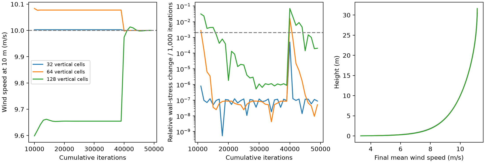

# Stabilizing the flat-bed CFD reference

## Purpose

The reference wind in the ridge grid study drifted during solver iteration. A bulk-speed target calibrated from a transient profile therefore did not maintain a 10 m/s reference wind at 10 m. This experiment settles the flat-bed profile before recalibrating its forcing.

## Procedure

Continue from the flat-bed states at iteration 9,000. Preserve the 32 m lid height, periodic wavelength, wall function, aerodynamic roughness and each vertical grid. The flat fields are nearly uniform horizontally. Average the existing fields across columns and retain two periodic columns with the same wall-normal cell spacing. The maximum horizontal departure in streamwise velocity before averaging was below 0.000002 m/s. These reduced cases accelerate the steady flat-bed calculation.

Run 30,000 additional iterations at the existing bulk target. Measure the settled wind at 10 m, multiply the bulk target by 10 divided by this wind, and run another 10,000 iterations. Evaluate the final two consecutive 1,000-iteration windows. The proposed acceptance limits are relative wall-stress change below 0.002, maximum velocity-profile change below 0.01 m/s and final wind at 10 m within 0.5% of target.

Iteration count is an algorithmic index. Changing the horizontal grid changed the convergence history. A 1,000-iteration continuation starting from the original transient fine-grid solution differed from its reduced equivalent by 0.303 m/s in streamwise velocity and 2.51% in wall stress. Consequently the reduced iteration history cannot stand in for the original grid history. Validate the settled state by mapping it back onto all three full grids and running a further 1,000 iterations.

## Reproduction

Use OpenCFD OpenFOAM v2312 with the same container and source revision as the preceding studies. The scripts preserve existing cases by refusing to overwrite output directories.

```text
python AeoLiS_Investigation/07_reproducibility/scripts/flat_reference_stability.py tmp/ridge-grid-study tmp/flat-stability
```

Run blockMesh, checkMesh and simpleFoam in each generated case. Save output to log.mesh, log.check and log.solve. Generate cell centres with postProcess -func writeCellCentres -time 30000. Then recalibrate and run simpleFoam again, saving output to log.calibrate.

```text
python AeoLiS_Investigation/07_reproducibility/scripts/flat_reference_stability.py tmp/ridge-grid-study tmp/flat-stability --calibrate
python AeoLiS_Investigation/07_reproducibility/scripts/flat_reference_stability.py tmp/ridge-grid-study tmp/flat-stability --expand tmp/flat-equilibrium-check
```

Run blockMesh, checkMesh and simpleFoam in each full-grid check case, saving the same three logs. Analyze from the repository root.

```text
python AeoLiS_Investigation/07_reproducibility/scripts/analyze_flat_stability.py tmp/flat-stability tmp/flat-equilibrium-check
```



## Results

All three reduced cases passed the proposed stability criteria over the final two consecutive 1,000-iteration windows. The following values are from the reduced cases after calibration. Kinematic stress is wall stress divided by density, in m²/s².

| Original grid | Vertical cells retained | Final wind at 10 m (m/s) | Bulk target (m/s) | Kinematic wall stress |
|---|---:|---:|---:|---:|
| 64 × 32 | 32 | 10.000000 | 10.175156 | 0.187307 |
| 128 × 64 | 64 | 10.000000 | 10.173266 | 0.187535 |
| 256 × 128 | 128 | 10.000345 | 10.173696 | 0.187708 |

The fine-grid wall stress changed by at most 0.0204% per 1,000-iteration window over the final two windows. Its maximum velocity-profile change was 0.00155 m/s. The coarse and medium cases were more stable.

All three full-grid mesh checks and solver runs passed. After mapping the calibrated profiles back, a further 1,000 full-grid iterations changed the mean streamwise velocity profile by at most 0.00000013, 0.00000031 and 0.000260 m/s on the coarse, medium and fine grids. Relative wall-stress changes were below 0.000004% on the first two grids and 0.00761% on the fine grid. This supports using the settled reference state on the original flat grids. It does not establish equivalence of the earlier transient iteration histories.

## Consequence for the ridge study

The flat reference now meets the stated numerical stability and wind-matching limits. The medium-to-fine change in its wall stress is approximately 0.092%. That value is an observed grid difference, not an extrapolated continuum error bound. Ridge simulations still need to be run using these calibrated bulk targets and appropriate initial profiles. Their current saved results used earlier forcing and reference states. Changing only the normalization denominator would combine different experiments and would not provide a matched comparison.

The next experiment reruns both ridge heights with these targets on each grid, checks ridge-profile stability and then recomputes the AeoLiS discrepancy. The lid-height and turbulence-closure sensitivity studies remain open. The present step establishes a CFD reference, with correction training and independent evaluation still ahead.

The machine-readable summary stores the calibration, per-window diagnostics and full-grid checks. Final reduced profiles are saved as NPZ files for all fields, and compressed mesh and solver logs accompany the results.
