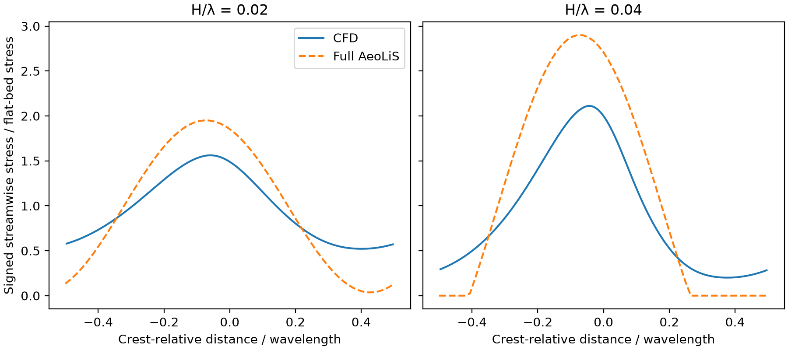

# Does the shear discrepancy increase with ridge steepness?

The [subsequent grid and iteration study](ridge_grid_study.md) revisits these preliminary results. Its finest-grid discrepancy increase is about 55%, and it identifies remaining reference-wind drift and grid sensitivity. The 72% value below describes the original 3,000-iteration medium-grid comparison.

At 32 m wavelength, compare cosine amplitudes of 0.64 and 1.28 m on the same 128 × 64 CFD grid. The OpenFOAM cases use the geometry, closure, lid and roughness in the [pilot protocol](ridge_cfd_findings.md). Each ridge uses the same bulk-speed target as the calibrated flat bed. The pressure gradient adjusts per case.

AeoLiS prescribes 10 m/s at 10 m above the surface. On the original flat CFD mesh, average streamwise velocity horizontally at each cell-centre elevation and linearly interpolate to 10 m. At iteration 3,000 this gives 10.01773 m/s for a bulk target of 10 m/s. Multiplying that target by 10/10.01773 gives 9.98230 m/s. Rerun the flat control and both ridges from their initial fields; check the resulting flat-bed wind at the reference height.

For each model normalize signed streamwise stress by its own flat-bed stress. Interpolate the full AeoLiS profile to the CFD face centres before calculating the root mean square difference over one wavelength. This diagnostic weights the entire profile equally. A two-case comparison on one grid estimates sensitivity within this configuration.

## Reproduction

Use OpenCFD v2312. Run the original flat-128 pilot first. In that case directory run `postProcess -func writeCellCentres -time 3000`. From the repository root run the preparation command below. Run `blockMesh`, `checkMesh` and `simpleFoam` in each generated case, saving the mesh check output as log.check. Run the analysis command from the repository root.

```text
python AeoLiS_Investigation/07_reproducibility/scripts/matched_ridge_pair.py prepare tmp/ridge-cfd/flat-128 tmp/ridge-matched
python AeoLiS_Investigation/07_reproducibility/scripts/matched_ridge_pair.py analyze tmp/ridge-cfd/flat-128 tmp/ridge-matched
```



## Results

All three meshes passed checkMesh. After 3,000 iterations the new flat-bed control gave 10.00097 m/s at 10 m. Normalized stresses and differences are dimensionless.

| H/λ | CFD minimum | AeoLiS minimum | CFD peak | AeoLiS peak | CFD peak x (m) | Profile RMSE | Last-250-iteration CFD profile drift (maximum) |
|---|---:|---:|---:|---:|---:|---:|---:|
| 0.02 | 0.521 | 0.036 | 1.562 | 1.950 | −1.875 | 0.325 | 0.0019 |
| 0.04 | 0.201 | 0.000 | 2.112 | 2.900 | −1.375 | 0.558 | 0.0049 |

On this grid the profile discrepancy increases by 72% when ridge amplitude doubles. CFD wall stress stays positive in both cases. At H/λ = 0.04 the previous medium-grid peak was 2.112, so matching the reference-height wind has little effect on that peak. The previous steep-ridge refinement shifted the CFD peak position by 0.56 m. The apparent phase change between steepness cases (0.50 m) therefore needs a matched refinement study before physical interpretation. Field accuracy and transfer to other dune geometries are open.
