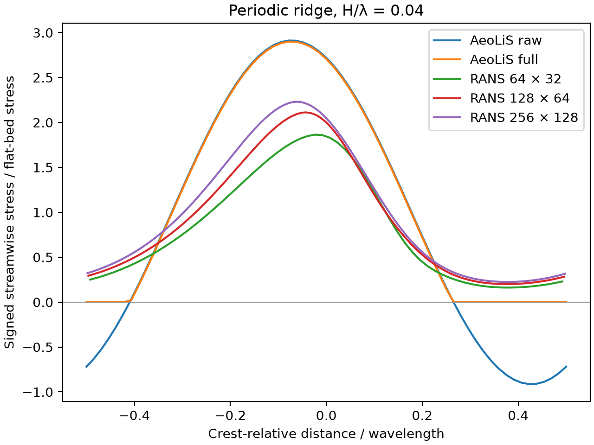

# Periodic ridge CFD comparison

## Case and observable

The bed follows a cosine of amplitude 1.28 m and wavelength 32 m. The crest is at x = 0. Wind blows along positive x. Each OpenCFD OpenFOAM v2312 case solves steady incompressible RANS with the standard k-epsilon closure, cyclic end faces, a symmetry lid at 32 m and an empty spanwise direction. A mean-velocity force maintains a bulk velocity of 10 m/s. Each ridge has a flat-bed control at the same resolution, forcing target and roughness length (0.001 m). The pressure gradient adjusts separately in each case.

We compare the **global streamwise component** of the wallShearStress output, divided by its signed mean on the corresponding flat wall. This removes the OpenFOAM traction sign convention and density factor. Coordinates are bed-face midpoints. Zero on the AeoLiS full-model curve denotes zero predicted streamwise stress with its optional separation correction disabled. Negative CFD wall stress would identify locally reversed traction. A recirculating flow region would also need velocity-field evidence.

The setups share wavelength, amplitude and aerodynamic roughness. OpenFOAM prescribes bulk speed, whereas AeoLiS uses wind at a reference height. The finite lid, steady two-dimensional closure, wall treatment and different horizontal boundary treatments limit interpretation. A field-accuracy claim needs independent observations. OpenFOAM roughness condition details are in the [v2312 wall-function documentation](https://doc.openfoam.com/2312/tools/processing/boundary-conditions/rtm/derived/atmospheric/atmNutkWallFunction/).

## Reproduction

From the repository root, generate six cases with the command below. Grid labels 64, 128 and 256 denote streamwise cells per wavelength, with half as many vertical cells and wall-normal expansion ratio 16. In each case directory, run the three OpenFOAM commands in order under v2312, recording their output. Inspect mesh quality, the solver log and wall-stress stability. Then run the comparison script with the existing AeoLiS profile CSV in the results directory.

```text
python AeoLiS_Investigation/07_reproducibility/scripts/prepare_ridge_cfd.py tmp/ridge-cfd
blockMesh
checkMesh
simpleFoam
python AeoLiS_Investigation/07_reproducibility/scripts/compare_ridge_cfd.py tmp/ridge-cfd
```



## Results at iteration 3,000

All six meshes passed checkMesh. All three ridge solutions retained positive streamwise wall stress over the sampled bed. Values below use matched flat-bed normalization. The last column is the maximum pointwise change in the normalized profile from iteration 2,750 to 3,000.

| Grid | Minimum | Peak | Peak position from crest (m) | Last-interval change |
|---|---:|---:|---:|---:|
| 64 × 32 | 0.162 | 1.864 | −0.750 | 0.0150 |
| 128 × 64 | 0.201 | 2.112 | −1.375 | 0.0049 |
| 256 × 128 | 0.225 | 2.230 | −1.938 | 0.0091 |

The AeoLiS full-model peak (2.900 at −2.50 m) exceeds the finest RANS peak by about 30%. The CFD peak moved 0.563 m between the last two grids, comparable to the 0.562 m difference between the finest CFD and AeoLiS peak positions. A physical phase bias cannot yet be resolved from these runs. Peak magnitude increased about 5.6% from medium to fine. Further iterative and grid convergence, a lid-height sensitivity check and a flat-bed reference-height wind match are needed before assigning an accuracy bound. These results are a pilot comparison for one geometry.
