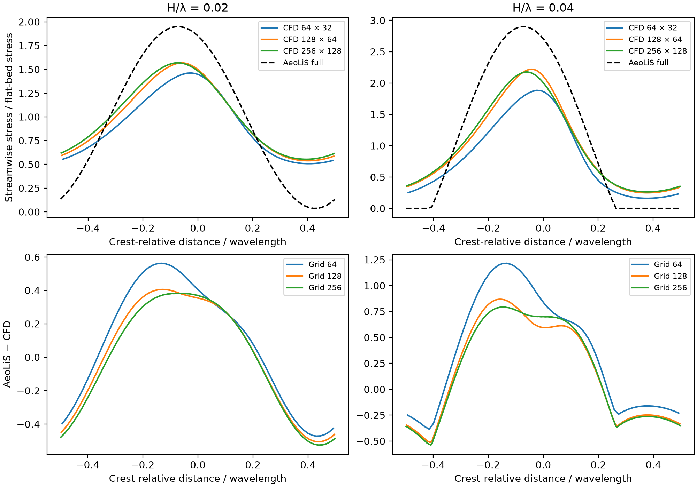

# Grid sensitivity of the matched ridge comparison

## Question

Does increasing ridge steepness increase the difference between AeoLiS and CFD after refining the CFD grid and allowing more solver iterations?

## Method

Use the periodic RANS configuration in the [pilot report](ridge_cfd_findings.md). At each of 64 × 32, 128 × 64 and 256 × 128 cells, run a flat bed and cosine ridges with H/λ = 0.02 and 0.04, λ = 32 m and z0 = 0.001 m. Calibrate each grid's bulk target using its original flat-bed wind at 10 m. Run to iteration 6,000 and measure the achieved reference wind. Recalibrate the bulk target by multiplying it by 10 divided by the measured reference wind. Restart all three cases on each grid from iteration 6,000 and continue to 9,000. Compare the final profiles with both 8,750 and 8,000 to assess iteration drift after the forcing change.

Normalize each ridge's streamwise stress by its own grid's flat-bed stress at the same iteration. Compare CFD profiles between adjacent grids by interpolating the coarser profile to fine cell centres within their shared extent. Compare AeoLiS by interpolating its existing full-model profile to CFD cell centres. AeoLiS remains on its original 0.5 m grid. These runs assess CFD grid sensitivity, with AeoLiS resolution and domain sensitivity still open.

The lid remains at 32 m, the turbulence closure remains steady two-dimensional k-epsilon and the wall-normal expansion ratio remains 16. Mesh refinement changes near-wall cell height as well as streamwise spacing. The full-model AeoLiS configuration has its optional separation correction disabled. The CFD periodic terrain and the central ridge sampled in the finite AeoLiS terrain retain different boundary treatments.

## Reproduction

Use OpenCFD OpenFOAM v2312. The container used for the pilot was opencfd/openfoam-default:2312 with digest sha256:097e45046a74ee1dae3e6135df0c42723ba55092d246e7c9932f3bfa1e89b7b2. Start from the original pilot flat-bed outputs at iteration 3,000, including the cell-centre field C generated by postProcess. The generator preserves existing directories by refusing to overwrite them.

```text
python AeoLiS_Investigation/07_reproducibility/scripts/ridge_grid_study.py prepare tmp/ridge-cfd tmp/ridge-grid-study
```

In each of the nine generated case directories, run the following commands with an OpenFOAM v2312 environment.

```sh
blockMesh > log.mesh
checkMesh > log.check
simpleFoam > log.solve
```

After all initial runs finish, recalibrate using the command below. Then run simpleFoam again in each case, saving its output to log.continue. Each restart uses the existing latest fields.

```text
python AeoLiS_Investigation/07_reproducibility/scripts/ridge_grid_study.py recalibrate tmp/ridge-cfd tmp/ridge-grid-study
```

From the repository root run the analysis. Its outputs include profiles, a machine-readable summary with input hashes and compressed mesh-check and solver logs. Full fields remain in the local case directories.

```text
python AeoLiS_Investigation/07_reproducibility/scripts/ridge_grid_study.py analyze tmp/ridge-cfd tmp/ridge-grid-study
```



## Results at iteration 9,000

All nine meshes passed checkMesh and all nine solver runs completed. Each reported stress is normalized by the signed flat-bed stress from the same grid at the same iteration.

| Grid | H/λ | Minimum | Peak | Peak x (m) | AeoLiS–CFD profile RMS difference | Maximum change over last 1,000 iterations |
|---|---|---:|---:|---:|---:|---:|
| 64 × 32 | 0.02 | 0.507 | 1.462 | −0.750 | 0.362 | 0.0010 |
| 64 × 32 | 0.04 | 0.161 | 1.883 | −0.750 | 0.654 | 0.0006 |
| 128 × 64 | 0.02 | 0.538 | 1.568 | −1.875 | 0.327 | 0.0040 |
| 128 × 64 | 0.04 | 0.249 | 2.220 | −1.375 | 0.506 | 0.0186 |
| 256 × 128 | 0.02 | 0.553 | 1.569 | −2.313 | 0.328 | 0.0017 |
| 256 × 128 | 0.04 | 0.263 | 2.176 | −1.938 | 0.508 | 0.0067 |

Final flat-bed winds at 10 m were 10.007, 10.002 and 9.831 m/s for the coarse, medium and fine grids. The fine-grid residual mismatch is 1.69%. The initial calibration using iteration 3,000 did not persist as the solutions evolved. A second adjustment at iteration 6,000 improved the coarse and medium matches, but fine-grid wind still drifted. Reference wind and wall stress therefore need an explicit stability criterion before calibrating again.

The profile discrepancy increases with steepness on all grids. On the finest grid its increase is approximately 55%, versus the preliminary 72% at iteration 3,000 on the medium grid. All sampled CFD stresses remain positive. The AeoLiS minima are 0.036 and 0, and its peaks are 1.950 and 2.900 for the gentle and steep ridges respectively. The refined comparison supports the direction of the earlier discrepancy while changing its estimated size.

Medium-to-fine refinement moved the CFD peak 0.438 m for the gentle ridge and 0.563 m for the steep ridge. The finest CFD peak on the gentle ridge is close to the raw AeoLiS harmonic peak at −2.314 m. This demonstrates why peak-position conclusions from the earlier medium grid were premature. Differences between entire CFD profiles also remain, even when their peak magnitudes agree closely.

## Interpretation and next decision

These runs provide a grid-sensitivity study with measured iteration drift. They do not yet yield a converged CFD error bound. Differences between grids combine discretization, the remaining difference in reference wind and the degree of iterative settling. Fitting a correction to these profiles would inherit those uncertainties.

The next solver work is to stabilize the flat-bed reference profiles and repeat the reference-height match, then assess a larger lid height. A practical acceptance criterion should be fixed before that run. Proposed criteria are a final reference wind within 0.5% of 10 m/s and maximum normalized stress-profile change below 0.002 over each of two consecutive 1,000-iteration windows. These tolerances are proposed research choices. They have not been met across the present matrix. After numerical uncertainty is controlled, compare existing AeoLiS parameter and separation settings, then evaluate a correction on held-out dune cases.
