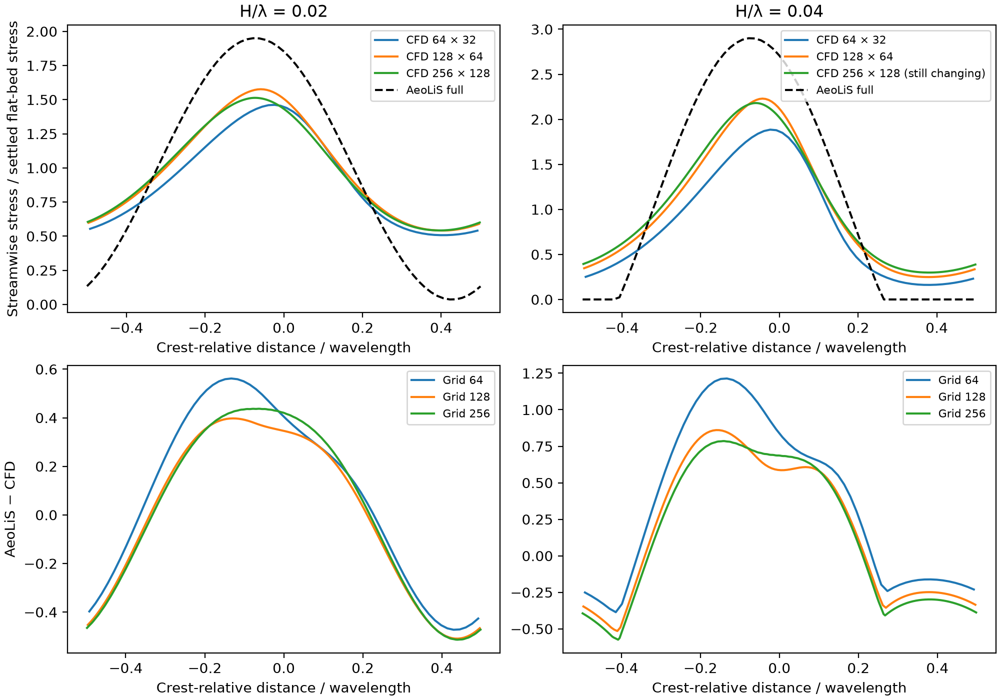
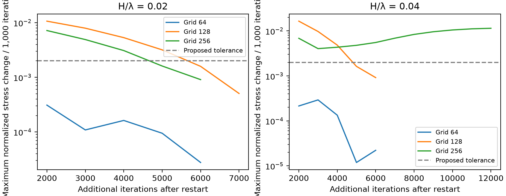

# Ridge shear against stabilized CFD flat-bed references

## Purpose

Revisit the two ridge heights using the [settled flat-bed reference](flat_reference_stability.md). This removes the earlier dependence on transient flat-bed normalization and uses bulk targets calibrated from stable reference winds at 10 m.

## Method

The wavelength is 32 m and H/λ is 0.02 or 0.04. The grids are 64 × 32, 128 × 64 and 256 × 128. Roughness, lid height, closure, wall functions and spatial schemes follow the [original CFD setup](ridge_cfd_findings.md). The bulk targets are 10.175156, 10.173266 and 10.173696 m/s, respectively. They generate approximately 10 m/s wind at 10 m over the corresponding flat beds. The forcing maintains the prescribed bulk velocity in each ridge case, with its pressure gradient adjusting accordingly.

Initialize from the corresponding previous ridge at iteration 9,000 to retain the terrain-adjusted flow. Scale velocity and turbulent viscosity by the ratio of new to previous bulk speed, pressure and turbulent kinetic energy by its square, and dissipation by its cube. This provides a dimensional warm start. Run a further 6,000 iterations at the calibrated target. Compare the maximum normalized wall-stress change over each of the final two consecutive 1,000-iteration windows with the previously proposed 0.002 tolerance.

Normalize each ridge's wall stress by the corresponding settled full-grid flat-bed check at iteration 1,000. The checks had already demonstrated that the settled flat profiles persist on the full grids. The fixed reference denominator makes the reported iteration changes depend on ridge evolution. Interpolate the saved AeoLiS full-model profile to CFD face centres when calculating RMS differences. AeoLiS retains the 0.5 m grid and optional separation correction disabled from the preceding experiments.

## Reproduction

Use OpenCFD OpenFOAM v2312 and the saved previous ridge and settled reference cases. Generate fresh cases from the repository root.

```text
python AeoLiS_Investigation/07_reproducibility/scripts/stable_reference_ridges.py prepare tmp/stable-reference-ridges
```

In each case run the following commands using an OpenFOAM v2312 environment.

```sh
blockMesh > log.mesh
checkMesh > log.check
simpleFoam > log.solve
```

Analyze from the repository root. The script reports stability flags, profiles, model differences and differences between adjacent CFD grids. It preserves compressed mesh and solver logs.

```text
python AeoLiS_Investigation/07_reproducibility/scripts/stable_reference_ridges.py analyze tmp/stable-reference-ridges
```

The medium gentle case required one additional 1,000-iteration window. Set startFrom to latestTime and endTime to 7000, run simpleFoam and save the log as log.to-7000. The fine steep case was extended to 12000 with the log saved as log.to-12000. To select each case's latest completed output, use the command below after every solver process has finished.

```text
python AeoLiS_Investigation/07_reproducibility/scripts/stable_reference_ridges.py analyze tmp/stable-reference-ridges --time 0
```



## Results

All six meshes passed checkMesh and all six solver runs completed. Five cases met the proposed two-window wall-stress stability criterion. The fine steep ridge still changed above tolerance after the extension. Values in that row describe its final saved state.

| Grid | H/λ | Additional iterations | Minimum stress | Peak stress | AeoLiS–CFD profile RMS difference | Maximum changes in final two windows | Criterion met |
|---|---|---:|---:|---:|---:|---|---|
| 64 × 32 | 0.02 | 6,000 | 0.507 | 1.462 | 0.362 | 0.000095, 0.000028 | Yes |
| 64 × 32 | 0.04 | 6,000 | 0.161 | 1.885 | 0.653 | 0.000012, 0.000022 | Yes |
| 128 × 64 | 0.02 | 7,000 | 0.541 | 1.576 | 0.325 | 0.001589, 0.000507 | Yes |
| 128 × 64 | 0.04 | 6,000 | 0.249 | 2.230 | 0.502 | 0.001630, 0.000917 | Yes |
| 256 × 128 | 0.02 | 6,000 | 0.542 | 1.513 | 0.343 | 0.001611, 0.000908 | Yes |
| 256 × 128 | 0.04 | 12,000 | 0.298 | 2.180 | 0.507 | 0.011134, 0.011467 | No |

Stress and RMS differences are normalized by settled flat-bed stress. All final sampled CFD wall stresses are positive. The AeoLiS full-model minima remain 0.036 and 0, with peaks 1.950 and 2.900, for H/λ = 0.02 and 0.04 respectively. Both medium-grid cases pass the chosen criterion and their profile discrepancy increases by approximately 55% with steepness. This is a comparison within one periodic RANS configuration. A converged fine-grid steep-ridge error estimate remains open.



## Interpretation

Stabilizing the reference removed a changing normalization denominator, but it did not settle every terrain solution. The fine steep-ridge maximum change grew from approximately 0.0048 to 0.0115 per 1,000 iterations during the extended run. Steady solver iteration is not physical time, so this drift alone cannot establish physically unsteady flow. Its cause needs numerical and flow-field diagnosis.

AeoLiS continues to predict larger peak amplification and lower lee-side stress than these CFD profiles. Differences between grids remain even for cases meeting the iteration criterion. The finite lid, two-dimensional steady closure, wall treatment, periodic bulk forcing and AeoLiS domain treatment remain sources of model and setup differences. These runs cannot isolate AeoLiS physical error from those effects.

The next diagnostic should examine the fine steep case's velocity, turbulence and pressure-gradient histories, and test numerical controls while preserving the stated geometry and forcing. Then assess lid-height sensitivity and AeoLiS configuration sensitivity. A correction should be evaluated after its reference target has adequate numerical stability. The present saved fine steep profile should not be used as a converged training label.
