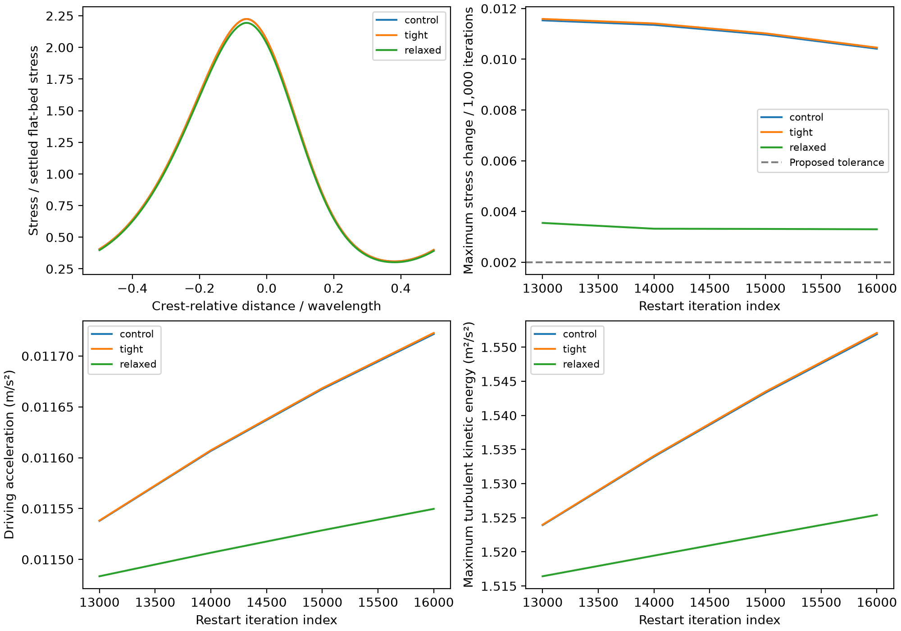

# Numerical diagnosis of the fine steep ridge

## Question

Why did the 256 × 128 periodic ridge at H/λ = 0.04 fail the two-window wall-stress stability test after 12,000 additional iterations?

## Controlled comparison

Copy the exact iteration-12,000 restart into three isolated cases. Preserve the mesh, fields, forcing target, roughness, lid, wall treatment, closure and discretization. Continue each to iteration 16,000. The case names identify the numerical changes below.

| Case | Linear solver controls | Relaxation factors |
|---|---|---|
| control | Absolute tolerance 1e-9, relative tolerance 0.01 | p 0.3, U 0.7, k and epsilon 0.6 |
| tight | Absolute tolerance 1e-10, relative tolerance 0 | Same as control |
| relaxed | Same as control | p 0.2, U 0.4, k and epsilon 0.3 |

The tight case tests whether inner equation solves affect the observed outer-iteration drift. The relaxed case tests sensitivity to the advancement of the nonlinear iteration. Reducing relaxation can reduce changes per iteration while slowing convergence. A smaller window change alone cannot establish a better solution. Compare final profiles, pressure-gradient histories, turbulence fields and agreement between cases as well.

Normalize wall stresses by the settled full-grid flat-bed reference. Record peak and minimum stress, the maximum profile change per 1,000 iterations, driving pressure gradient, extrema of turbulence quantities and volume-weighted bulk streamwise velocity. Use OpenFOAM cell volumes for the bulk velocity because wall-normal cell sizes differ. The arithmetic mean across cells is not the imposed bulk target.

## Reproduction

Use OpenCFD OpenFOAM v2312 and the original fine steep case and flat-bed check. From the repository root generate the cases.

```text
python AeoLiS_Investigation/07_reproducibility/scripts/diagnose_steep_ridge.py prepare tmp/steep-ridge-diagnosis
```

Run simpleFoam in each case and save its output to log.solve. In the control case also run the following OpenFOAM post-processing command to save the cell volumes.

```sh
postProcess -func writeCellVolumes -time 12000
```

Analyze after all three solvers finish. The outputs include a figure, histories, window changes, final differences from the control, compressed solver logs and the exact fvSolution dictionaries used.

```text
python AeoLiS_Investigation/07_reproducibility/scripts/diagnose_steep_ridge.py analyze tmp/steep-ridge-diagnosis
```



## Results at iteration 16,000

All three continuations completed. Hash checks confirm that U, p, k, epsilon, nut and phi in their restart fields are identical to the source checkpoint. The volume-weighted bulk speed stayed at the prescribed 10.173696 m/s. Sampled k and epsilon remained positive. The forcing pressure gradient and the turbulence field continued to evolve.

| Case | Final minimum stress | Final peak stress | Final two maximum window changes | Criterion met | Final profile RMS difference from control |
|---|---:|---:|---|---|---:|
| control | 0.309 | 2.225 | 0.010971, 0.010416 | No | 0 |
| tight | 0.309 | 2.225 | 0.011023, 0.010460 | No | 0.000129 |
| relaxed | 0.302 | 2.194 | 0.003314, 0.003300 | No | 0.018868 |

Stresses and differences use the settled flat-bed reference. The maximum wall-stress change occurs approximately 1.7–1.8 m upstream of the crest. In the control, the driving acceleration increased from 0.011459 m/s² at the common restart to 0.011722 m/s² at the final checkpoint, while maximum turbulent kinetic energy increased from 1.513 to 1.552 m²/s². The flow is adjusting beyond the wall-stress diagnostic.

## What the tests resolve

The tight solution remains extremely close to the control while both have similar window drift. This indicates that the tested linear solver tolerances are not the dominant explanation for the drift. This conclusion concerns the tested settings, checkpoint and observation interval.

Lower relaxation reduces changes per iteration, but its final stress profile lags the control and resembles an earlier point on the control trajectory. This is consistent with slower nonlinear advancement. It did not satisfy the proposed criterion or demonstrate a converged improvement. A reduction in iteration drift cannot be interpreted as an improvement in physical accuracy.

The three runs narrow the numerical diagnosis. They do not establish a steady solution, a continuum error bound or physically unsteady flow. Steady solver iteration is not physical time. Turbulence and pressure-gradient evolution warrant further examination before assigning a physical explanation.

## Next experiment

Continue the control with window-based monitoring and inspect whether the coupled pressure-gradient and turbulence histories approach plateaus. Retain the original window criterion and verify that several observables settle together. Compare an independently initialized restart to test whether the same solution is reached. If persistent drift or cycling remains, investigate spatial schemes, turbulence wall treatment and a time-resolved calculation with an appropriate time-step study. Lid-height and model-form sensitivity remain separate requirements before interpreting AeoLiS accuracy. The present fine steep result remains unsuitable as a converged correction-training target.
